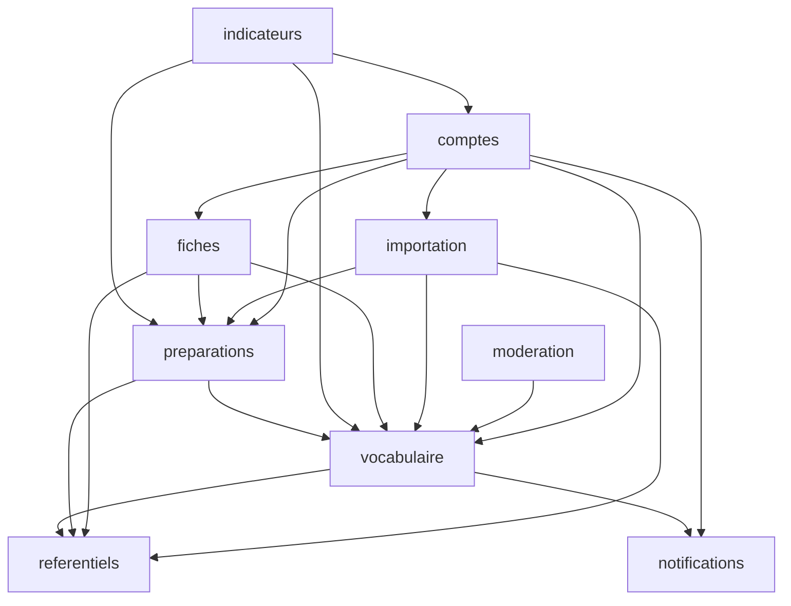
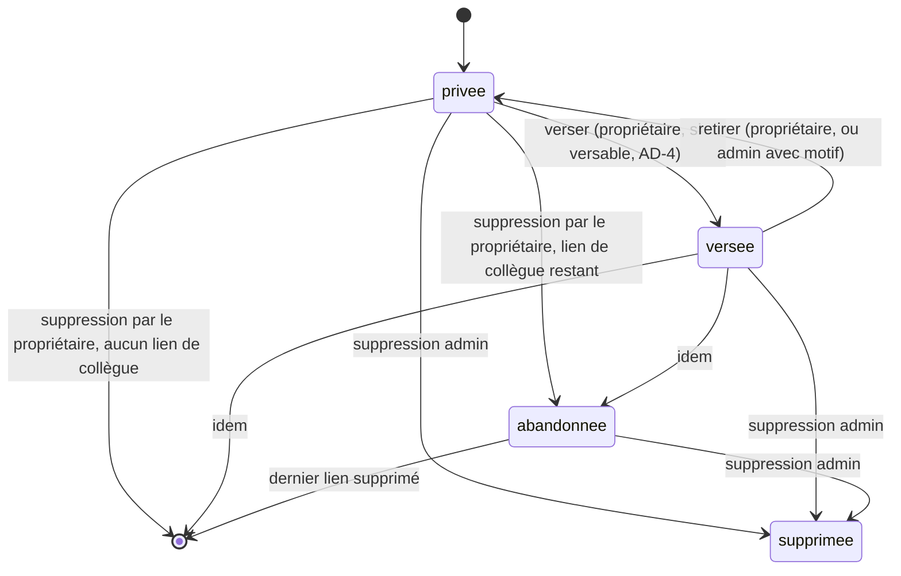
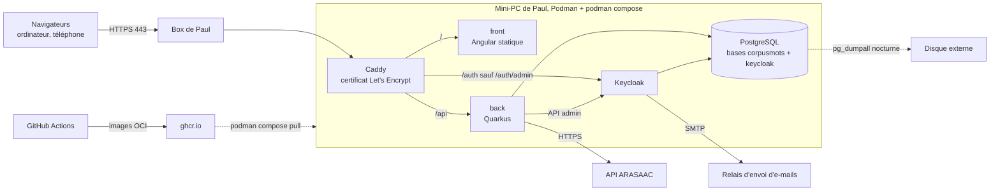
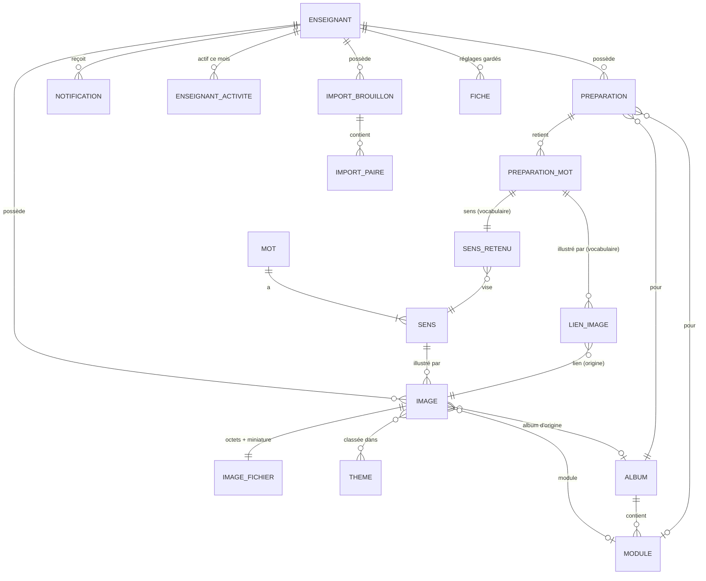

# Architecture Spine — corpus-mots

## Design Paradigm

**Monolithe modulaire.** Un seul back Quarkus, découpé en modules de domaine ; chaque module a trois couches (`api` REST → `service` → `persistance`). Le front Angular est une application séparée qui ne parle qu'à l'API du back. Keycloak gère l'identité ; PostgreSQL stocke tout, images comprises.

| Couche (dans chaque module) | Paquetage | Contenu |
| --- | --- | --- |
| API | `fr.corpusmots.<module>.api` | Ressources REST, DTO d'entrée/sortie |
| Service | `fr.corpusmots.<module>.service` | Règles métier, transactions ; **seule API publique du module** pour les autres modules |
| Persistance | `fr.corpusmots.<module>.persistance` | Entités JPA, Repositories ; privée au module |

Modules : `commun`, `comptes`, `referentiels`, `vocabulaire`, `notifications`, `preparations`, `importation`, `fiches`, `moderation`, `indicateurs`.

## Invariants & Rules

### AD-1 — Dépendances entre modules [ADOPTED]

- **Binds:** tous les modules du back
- **Prevents:** les cycles et les modules qui lisent ou écrivent les tables d'un autre
- **Rule:** un module n'appelle un autre module que par sa couche `service`, et seulement dans le sens du graphe ci-dessous. Chaque table appartient à un seul module ; aucun module n'accède aux entités ou Repositories d'un autre. Entre modules, on se référence **par UUID**, sans relation JPA ni clé étrangère SQL (AD-22). Remonter une flèche du graphe ne se fait que par AD-15. Un test ArchUnit fige ce graphe.



Tout module peut dépendre de `commun` (erreurs, identifiants, interface `EnseignantCourant`). `commun` ne dépend de rien.

### AD-2 — Une seule règle de visibilité, trois prédicats [ADOPTED]

- **Binds:** FR-7, FR-8, FR-9, FR-15, FR-18, FR-21, FR-26, FR-31, toute lecture d'Image ou de fichier image
- **Prevents:** qu'un module montre une Image non versée d'un collègue ; qu'une Image retirée soit de nouveau réutilisée ; un passe-droit implicite de l'administrateur
- **Rule:** `vocabulaire.service.VisibiliteImages` est le seul composant qui décide de ce qu'un enseignant voit. Il expose trois prédicats, et aucun autre :
  - `consultable(image, enseignant)` : il en est propriétaire et l'état est `privee` ou `versee` ; ou l'état est `versee` ; ou il a un lien vers elle (AD-14), auquel cas elle n'est montrée **que dans la Préparation qui la lie** et dans les Fiches de cette Préparation.
  - `proposable(image, enseignant)` (détection, FR-7, FR-9, Banque, filtres, Fiches par filtre, Import) : il en est propriétaire et l'état est `privee` ou `versee` ; ou l'état est `versee`. **Un lien ne rend jamais une Image proposable.**
  - `moderable(image)` (réservé à `moderation`) : l'état est `versee` ou `abandonnee`.

  Le rôle `admin` n'élargit aucun autre prédicat. Un Mot ou un Sens n'est révélé que s'il porte une Image `proposable` ou figure dans une Préparation de l'enseignant ; sinon le Mot est présenté comme nouveau. Les Albums montrés pour un Mot (FR-8) sont l'album d'origine des Images `proposable` et les Albums des Préparations **de l'enseignant lui-même**, jamais ceux des Préparations d'un collègue. Le classement de FR-9 (Section de la Préparation d'abord, puis Images déjà liées à ce Sens dans d'autres Albums) est calculé uniquement par `vocabulaire.service`.

### AD-3 — Cycle de vie d'une Image [ADOPTED]

- **Binds:** FR-19, FR-20, FR-21, FR-30, FR-31, FR-32, FR-33
- **Prevents:** deux chemins de modification de l'état d'une Image ; un retrait sans notification ; des Images orphelines
- **Rule:** une Image a un `etat` parmi `privee`, `versee`, `abandonnee`, `supprimee`. Seul `vocabulaire.service` modifie `etat`, avec un `Acteur` explicite (`Proprietaire(id)` ou `Administrateur(id, motif)`) ; `moderation` et `comptes` l'appellent. Les actions d'administrateur sur une Image ne sont exposées que par `moderation.api` ; `vocabulaire.api` n'expose que celles du propriétaire.



  - « Lien de collègue » = un lien (AD-14) dont l'enseignant n'est pas le propriétaire. Quand le propriétaire supprime une Image, ses propres liens sont supprimés dans la même transaction (le Mot redevient « à illustrer » dans ses Préparations).
  - `abandonnee` : invisible pour le propriétaire, conservée pour les liens des collègues. `supprimee` : fichiers effacés, ligne gardée comme pierre tombale.
  - Un retrait par l'administrateur enregistre `retrait_admin_motif` (`licence_non_conforme`, `image_album`, `image_inadaptee`, `autre` + texte obligatoire). Tant qu'il est renseigné, `verser` est refusé jusqu'à ce que le propriétaire modifie la Carte d'identité. Si le propriétaire est un compte supprimé, le retrait admin vaut suppression par le propriétaire.
  - L'état affiché « à remplacer » (`retiree` si l'Image liée n'est plus `versee` et que le lecteur n'en est pas propriétaire ; `supprimee`) est calculé à la lecture par `vocabulaire.service`, renvoyé dans les vues, et jamais copié dans une autre table.
  - Les `Notification` ne sont créées **que** par `vocabulaire.service`, dans la méthode qui fait la transition et dans sa transaction. Destinataires : le propriétaire si l'acteur est l'administrateur, plus chaque enseignant distinct ayant un lien vers l'Image, pour `versee → privee`, `→ abandonnee` et `→ supprimee`. Une Notification stocke un instantané (`type`, `image_id`, `mot_forme`, `sens_libelle`, `motif`, `texte_motif`, `cree_le`, `lue_le`), jamais le fichier ni le nom de l'acteur.

### AD-4 — Types, licences et conditions pour verser [ADOPTED]

- **Binds:** FR-13, FR-17, FR-19, FR-24, UJ-3, §6.1
- **Prevents:** qu'un écran ou un import contourne les règles de licence ; deux listes de valeurs qui divergent
- **Rule:** deux énumérations fermées et distinctes. `type_image` = `image_album`, `image_libre`, `photo_personnelle`, `inconnu`. `licence` = `arasaac_cc_by_nc_sa`, `sclera_cc_by_nc`, `mulberry_cc_by_sa`, `cc0_domaine_public`, `pixabay`, `autre_inconnue`, `droits_auteur_enseignant` (posée automatiquement pour une photo personnelle), `usage_pedagogique_album` (posée automatiquement pour une image d'album). Une Image est versable si et seulement si : `image_libre` avec une source non vide et une licence parmi les quatre premières ; ou `photo_personnelle`. Tout refus renvoie un `code` stable par motif (`image.versement.image_album`, `.type_inconnu`, `.licence_non_versable`, `.source_manquante`, `.retrait_admin`). Une `image_album` exige un Album ; passer une Image en `image_album` la réduit aussitôt à la taille d'AD-8. Le contrôle est fait par la seule méthode de `vocabulaire.service` qui verse ; le front et l'import lisent les énumérations dans le client généré.

### AD-5 — Réutiliser = lier [ADOPTED]

- **Binds:** FR-9, FR-14, FR-21, FR-22
- **Prevents:** des copies d'Images qui divergent ; une Image qui illustre un Sens qui n'est pas le sien
- **Rule:** une Préparation référence une Image par un lien (AD-14) ; on ne copie jamais une Image ni sa Carte d'identité. Seul le propriétaire modifie la Carte d'identité d'une Image. Le Sens d'une Image ne change que si elle n'a **aucun** lien, chez quiconque, propriétaire compris ; sinon le propriétaire ajoute une nouvelle Image. Invariant : pour tout lien, le Sens de l'Image est le Sens retenu pour ce Mot dans la Préparation.

### AD-6 — Identité : Keycloak d'un côté, Enseignant de l'autre [ADOPTED]

- **Binds:** FR-1, FR-2, FR-3, FR-32
- **Prevents:** deux sources de vérité pour un compte ; deux créateurs d'Enseignant ; une session qui survit à une désactivation
- **Rule:** Keycloak possède e-mail, mot de passe, rôle `admin`, sessions, e-mails d'invitation (lien 7 jours) et de réinitialisation. `comptes` possède `Enseignant` : `id` = `sub` Keycloak (seule exception à `uuidv7()`), nom affiché, `statut` (`invite`, `actif`, `desactive`, `suppression_en_cours`, `supprime`). Seul `comptes.service` insère dans `enseignant`, et seulement à l'invitation ; pas de création à la volée. `statut` est une copie écrite par `comptes.service` après succès de l'appel Keycloak ; en cas de divergence, Keycloak fait foi. Le rôle `admin` n'est jamais copié en base : il se lit dans le jeton ; la règle « au moins un administrateur » se vérifie auprès de Keycloak sous un verrou `pg_advisory_xact_lock`. Un filtre de `comptes` refuse toute requête dont le `sub` n'a pas d'`Enseignant` au statut `actif` (`403`, `compte.inconnu_ou_inactif`). Le back vérifie le jeton (OIDC bearer, durée de vie courte de l'access token) ; le front utilise le flux code + PKCE. Désactiver ou supprimer un compte révoque ses sessions Keycloak. Un `Enseignant` n'est jamais effacé physiquement : il est anonymisé (« ancien membre de l'équipe »). La console d'administration Keycloak n'est jamais exposée.

### AD-7 — Contrat front/back généré [ADOPTED]

- **Binds:** tout le front, toute l'API
- **Prevents:** un front qui appelle une API qui n'existe plus
- **Rule:** l'API est REST/JSON sous `/api`. Le document OpenAPI (3.1) est généré depuis le code Quarkus (SmallRye OpenAPI) ; le client TypeScript du front est généré depuis ce document par ng-openapi-gen et n'est jamais modifié à la main. Aucun appel HTTP écrit à la main dans le front, fichiers image compris (AD-23).

### AD-8 — Données et fichiers dans PostgreSQL [ADOPTED]

- **Binds:** FR-12, FR-13, FR-17, FR-23..FR-25, NFR sauvegarde
- **Prevents:** une base et des fichiers désynchronisés ; deux réductions d'image différentes
- **Rule:** les fichiers image sont stockés en `bytea` dans PostgreSQL, jamais sur disque. `vocabulaire.service.ReductionImages` est la seule implémentation de la réduction, appelée à l'enregistrement quelle que soit l'origine (téléversement, photo, ARASAAC, dépôt d'import). Ses constantes : image d'album ≤ 400 × 400 px ; autres types ≤ 1600 px sur le grand côté ; miniature ≤ 256 px ; métadonnées EXIF supprimées. Le schéma n'évolue que par migrations Flyway (AD-22).

### AD-9 — ARASAAC derrière le back [ADOPTED]

- **Binds:** FR-12, FR-29
- **Prevents:** un front dépendant d'un service tiers ; des Fiches cassées si ARASAAC change
- **Rule:** la recherche ARASAAC passe par un proxy dans `vocabulaire` ; le front ne l'appelle jamais. Un pictogramme choisi devient une Image ordinaire : fichier téléchargé **avant** la transaction (AD-17), copié en base, licence `arasaac_cc_by_nc_sa`, auteur et source renseignés automatiquement.

### AD-10 — Clé et recherche des Mots [ADOPTED]

- **Binds:** FR-8, FR-24
- **Prevents:** deux normalisations différentes ; la fusion de mots distincts (côte/côté)
- **Rule:** une seule fonction `vocabulaire.service.Lexique.normaliser` sert à la saisie, à l'import et à la recherche. Avant tout traitement : espaces réduites et rognées, apostrophes `’` unifiées en `'`. Article initial retiré : `le|la|les|un|une|des` suivi d'une espace, ou `l'`. Chaque Mot stocke `forme` (première saisie, sans article), `forme_cle` (minuscules NFC **avec accents**, unique dans l'école) et `forme_recherche` (`unaccent(forme_cle)`, non unique, index `pg_trgm`). La détection cherche sur `forme_recherche` : « cote » propose « côte » et « côté », deux Mots distincts. Pas de lemmatisation. Un jeu de tests partagé fixe les cas côte/côté, l’arbre, lapin, des.

### AD-11 — Import en brouillon [ADOPTED]

- **Binds:** FR-23, FR-24, FR-25
- **Prevents:** des Images créées avant vérification ; un import impossible à reprendre ou validé deux fois
- **Rule:** déposer des fichiers crée un `ImportBrouillon` persistant dans `importation` : paires extraites (Apache POI), octets déjà réduits par `ReductionImages`, corrections. Chaque paire stocke explicitement son Sens choisi (un Sens `proposable`, ou « nouveau Sens » + libellé) ; une paire dont le Mot a plusieurs Sens est signalée « Sens à choisir ». La validation crée les Images, via `vocabulaire.service`, dans Mes mots, à l'état `privee`, jamais versées ; elle est idempotente : chaque Image porte `import_paire_id` (unique), et le brouillon passe à `valide` dans la même transaction. Un brouillon validé ou abandonné depuis 30 jours est purgé.

### AD-12 — Fiches régénérées, jamais stockées [ADOPTED]

- **Binds:** FR-26..FR-29
- **Prevents:** des fichiers exportés périmés en base ; des crédits oubliés ; deux comportements face à une Image disparue
- **Rule:** `fiches` stocke les réglages et la source d'une Fiche (historique, « refaire en un clic »), pas les fichiers. Le .docx/.pptx est généré à la demande (Apache POI), en une requête synchrone. Les mentions d'attribution et références d'Album sont calculées à partir des Cartes d'identité, par un seul composant de crédits utilisé par les deux formats. Une Fiche de Préparation inclut les Images `consultable` liées (retirées comprises) ; une Image `supprimee` devient un cadre vide légendé « image supprimée » et est signalée dans la réponse. Une Fiche par filtre ne contient que des Images `proposable`. Si la Préparation source est supprimée, la Fiche est marquée `source_disponible = false` (événement AD-15).

### AD-13 — Noms du domaine en français [ADOPTED]

- **Binds:** tout le code, la base, l'API
- **Prevents:** des traductions divergentes du glossaire
- **Rule:** les termes du Glossaire du PRD s'écrivent en français, sans accents, dans le code, la base et l'API (`Mot`, `Sens`, `Image`, `Preparation`, `Album`, `Module`, `Theme`, `Fiche`, `verser`, `reutiliser`). Le vocabulaire technique reste en anglais (`Resource`, `Service`, `Repository`, `Dto`). Le module d'import s'appelle `importation` (`import` est un mot réservé Java).

### AD-14 — Registre des usages, propriété de `vocabulaire`

- **Binds:** AD-2, AD-3, AD-5, FR-8, FR-9, FR-15, FR-20, FR-21, FR-33, FR-34
- **Prevents:** une règle de visibilité qui devrait lire les tables de `preparations` ; deux propriétaires du lien Préparation→Image ; un lien vers une Image effacée
- **Rule:** les tables `sens_retenu` (Sens retenu pour un Mot d'une Préparation : `preparation_id`, `preparation_mot_id`, `sens_id`, `enseignant_id`, `album_id`, `section`) et `lien_image` (`preparation_id`, `preparation_mot_id`, `image_id`, `enseignant_id`, `album_id`, `section`, `origine`, `cree_le`) **appartiennent à `vocabulaire`**, avec une clé étrangère `lien_image.image_id → image.id`. Elles ne se modifient que par `vocabulaire.service.Usages` (`retenirSens`, `lierImage`, `delierImage`, `remplacerImage`, `libererPreparationMot`, `libererPreparation`, `changerContextePreparation`). `preparations` possède `preparation` et `preparation_mot` (ordre, Thème par défaut, nom, temps passé) et appelle `Usages` dans la même transaction ; il ne stocke ni `image_id` ni état d'Image. `lierImage` verrouille la ligne `image` puis vérifie `proposable`. `origine` = `nouvelle` si l'Image a été créée pour cette Préparation (dans la même transaction ou par l'Import qui l'alimente), sinon `reutilisee` ; dupliquer une Préparation copie les liens en `reutilisee`.

### AD-15 — Remonter le graphe : interfaces et événements synchrones

- **Binds:** AD-1, FR-4, FR-5, FR-11
- **Prevents:** une flèche inverse ; un module amont qui modifie les données d'un module aval ; deux endpoints de suppression pour une même entité
- **Rule:** quand un module amont doit consulter ou prévenir ses utilisateurs (fusion d'Albums, suppression d'un Module ou d'un Thème, suppression d'une Préparation), il déclare dans son paquetage `service` une interface `…Utilisation` (« est-ce utilisé ? ») ou un événement (`AlbumsFusionnes`, `ModuleSupprime`, `ThemeSupprime`, `PreparationSupprimee`). Les modules aval l'implémentent ou l'observent avec `@Observes` **synchrone**, dans la transaction de l'émetteur. `@ObservesAsync`, files de messages et `TransactionPhase.AFTER_*` sont interdits pour une règle de cohérence. Seul le module propriétaire d'une entité expose sa suppression ou sa fusion.

### AD-16 — Ce qui traverse une frontière

- **Binds:** tous les modules, AD-7
- **Prevents:** des entités JPA qui fuient d'un module à l'autre ; deux DTO de même nom qui faussent le client généré
- **Rule:** une méthode de `service` appelée par un autre module accepte et renvoie uniquement des `record` immuables déclarés dans `fr.corpusmots.<module>.service` (suffixe `Vue` ou `Commande`), jamais une entité, un Repository ou un DTO d'`api`. Les octets d'une Image ne sortent de `vocabulaire` que par `FichiersImages.lire(imageId, enseignantId, usage)`, qui applique AD-2. Les DTO REST ont un nom **unique dans tout le back** (préfixe de module si besoin : `BanqueImageDto`, `PreparationImageDto`) ; un test ArchUnit fait échouer le build sinon. Toute représentation REST d'une Image contient `id`, `proprietaireId`, `etat`, `aRemplacer` (`null`, `retiree`, `supprimee`) et `reutilisable`, calculés par `vocabulaire`.

### AD-17 — Transactions

- **Binds:** tous les modules, AD-3, AD-6, AD-9, AD-11
- **Prevents:** des notifications validées pour une action annulée ; une connexion bloquée pendant un appel réseau ; des écritures concurrentes incohérentes
- **Rule:** la transaction est ouverte par la méthode de `service` du module dont la ressource REST a reçu la requête ; toute méthode de `service` appelée par un autre module est `@Transactional(REQUIRED)` et la rejoint. `REQUIRES_NEW` et toute écriture hors de la transaction de la requête sont interdits, sauf dans les tâches planifiées d'AD-18. Aucun appel HTTP sortant (ARASAAC, Keycloak) n'a lieu pendant une transaction ouverte : on appelle d'abord, on écrit ensuite, on compense en cas d'échec. `image` porte une colonne `@Version` ; `lierImage` et toute transition d'AD-3 prennent `SELECT … FOR UPDATE` sur la ligne `image`.

### AD-18 — Opérations de compte : fermer d'abord, effacer ensuite

- **Binds:** AD-6, FR-1, FR-32, §6.2
- **Prevents:** un compte Keycloak sans Enseignant ou l'inverse ; un effacement RGPD partiel ; un compte supprimé qui peut encore se connecter
- **Rule:**
  1. *Supprimer* : (a) Keycloak `enabled=false` et révocation des sessions ; (b) une transaction ouverte par `comptes.service` : `statut = suppression_en_cours`, puis `fiches`, `importation`, `preparations` (qui libère ses usages, AD-14), `vocabulaire` (Images non versées effacées ou `abandonnee` selon AD-3 ; Images versées gardées, attribuées à « ancien membre de l'équipe ») et `notifications` purgent les données de l'enseignant, puis anonymisation et `statut = supprime` ; (c) Keycloak `DELETE`.
  2. *Inviter* : appel Keycloak, puis création d'`Enseignant` (`invite`) ; si la transaction échoue, l'utilisateur Keycloak est supprimé (compensation).
  3. *Désactiver, réactiver, changer de rôle* : Keycloak d'abord, base ensuite.

  Une tâche planifiée de `comptes` (au démarrage puis chaque heure) rejoue les étapes Keycloak restées en échec et supprime tout utilisateur Keycloak du realm sans `Enseignant`.

### AD-19 — Mot et Sens : une seule porte, sans propriétaire

- **Binds:** AD-2, AD-10, FR-8, FR-10, FR-14, FR-22, FR-24
- **Prevents:** des erreurs de doublon qui révèlent un Mot caché ; des Sens en double ; la modification d'un Sens partagé qui change les Images des collègues
- **Rule:** Mots et Sens ne se créent que par `Lexique.obtenirOuCreerMot(saisie)` et `obtenirOuCreerSens(motId, libelle, categorie)`, idempotentes (`INSERT … ON CONFLICT DO NOTHING` puis relecture), qui ne lèvent jamais d'erreur de doublon et ne renvoient au demandeur que ce qu'AD-2 l'autorise à voir. Un Sens dont le libellé normalisé égale celui d'un Sens existant du même Mot est réutilisé en silence. Un Mot ou un Sens n'est créé qu'à l'enregistrement d'un Mot de Préparation, d'une Image ou d'une paire d'Import validée, jamais pendant la détection. Mot (forme, article, genre) et Sens (libellé, catégorie grammaticale) n'ont pas de propriétaire et ne sont pas modifiables par les enseignants en V1 ; une correction passe par l'administrateur et ne change jamais le rattachement d'une Image.

### AD-20 — Annuaire des enseignants

- **Binds:** FR-15, FR-18, FR-32
- **Prevents:** des copies du nom d'un enseignant qui survivent à son anonymisation
- **Rule:** le nom affiché n'est stocké que dans `enseignant` (`comptes`). Les autres modules ne stockent et ne renvoient que des identifiants. Le front résout les noms par `GET /api/enseignants` (`id`, `nomAffiche`, `statut` ; exclut `invite`), mis en cache dans `commun/annuaire`. Les exports citent le champ `auteur` de la Carte d'identité, jamais le nom du propriétaire.

### AD-21 — Hébergement portable

- **Binds:** déploiement, PRD §6.3, Q-3
- **Prevents:** une installation liée au mini-PC qu'on ne pourrait pas déménager si l'hébergement à domicile est refusé
- **Rule:** tout ce qui dépend de la machine (domaine, chemins de sauvegarde, secrets, relais SMTP) est dans `deploiement/.env` ; `compose.yaml`, `Caddyfile` et la configuration du realm Keycloak (export JSON versionné dans `deploiement/keycloak/`, importé au démarrage, thème et textes en français) sont identiques partout. Les conteneurs tournent sous **Podman** (sans démon, en mode rootless), en développement comme en production ; `compose.yaml` suit la Compose Specification et se pilote par `podman compose`. Les images sont désignées par leur nom complet (`docker.io/library/postgres:18.6`, `quay.io/keycloak/keycloak:26.8`…), car Podman ne résout pas les noms courts sans invite. La même installation tourne sans modification sur tout hôte Linux avec Podman, par exemple un VPS dans l'UE. Seuls les ports 80 (obtention du certificat) et 443 sont ouverts sur la box ; en rootless, l'hôte autorise ces ports (`net.ipv4.ip_unprivileged_port_start=80`) et relance les conteneurs au démarrage (`podman-restart.service`, session persistante par `loginctl enable-linger`).

### AD-22 — Migrations et clés étrangères

- **Binds:** tous les modules, AD-1
- **Prevents:** deux migrations de même numéro ; des contraintes SQL qui bloquent une fusion entre modules
- **Rule:** une migration s'appelle `V<AAAAMMJJHHMM>__<module>_<objet>.sql` et ne touche que les tables de son module. Les clés étrangères SQL sont obligatoires à l'intérieur d'un module et interdites entre modules ; l'intégrité entre modules est assurée par les services (AD-14, AD-15, AD-18). Une migration publiée n'est jamais modifiée.

### AD-23 — Fichiers image dans le navigateur

- **Binds:** NFR « 500 Images en moins de 2 s », AD-2, AD-7
- **Prevents:** un jeton dans une URL ; des listes qui chargent des images pleine taille
- **Rule:** `image_fichier` stocke deux tailles : `octets` et `miniature` (AD-8). Le front charge une image uniquement par le client généré (`blob`) et l'affiche par `URL.createObjectURL`, via une directive partagée `commun/image-securisee` ; jamais de jeton dans une URL. Les listes demandent `?taille=miniature`. Les réponses portent `Cache-Control: private, max-age=86400` et un `ETag` égal à la version de l'Image.

### AD-24 — Indicateurs

- **Binds:** FR-32, FR-34, SM-4, SM-5
- **Prevents:** des requêtes SQL qui contournent AD-1 ; une méthode « toutes les Images » sans visibilité
- **Rule:** `indicateurs` ne lit que des méthodes d'agrégat déclarées par chaque module (`service.Statistiques…`), qui ne renvoient que des nombres et des taux, jamais d'identifiant d'Image ni de nom d'enseignant. Activité : le filtre de `comptes` enregistre `enseignant_activite(enseignant_id, mois)` au premier appel du mois ; cette table sert aussi au signalement des comptes inactifs depuis un an. Taux de réutilisation = liens `reutilisee` ÷ Mots illustrés, par Album ; « réutilisée d'un collègue » = propriétaire de l'Image ≠ enseignant du lien.

## Consistency Conventions

| Concern | Convention |
| --- | --- |
| Noms Java | Classes en PascalCase, termes du domaine en français (AD-13) : `PreparationResource`, `VersementService`, `ImageRepository` |
| Noms base | Tables et colonnes en snake_case français, au singulier : `mot`, `sens`, `image`, `lien_image` |
| Noms API | Ressources au pluriel, kebab-case : `/api/preparations/{id}/mots`, `/api/images/{id}/fichier` |
| Noms front | Dossiers par fonctionnalité calqués sur les modules du back : `src/app/preparations/`, `src/app/banque/`… |
| Identifiants | UUID générés par la base (`uuidv7()`), sauf `enseignant.id` = `sub` Keycloak (AD-6) |
| Dates | `timestamptz` en base, ISO 8601 UTC dans l'API ; affichage local français par le front |
| Erreurs | RFC 9457 `application/problem+json`, champ `code` stable (ex. `image.versement.licence_non_versable`) ; le front traduit `code` en message français (vouvoiement) |
| Énumérations | Valeurs en snake_case français, identiques en base, API et front |
| Listes | Pagination `?page=&taille=` (taille max 100), réponse `{ elements, total }` ; filtres en paramètres de requête nommés comme les champs |
| Gestes annulables | « Annuler » (bandeau UX) = appel de l'opération inverse, pas de validation différée côté serveur |
| Session | Sur `401`, le front renouvelle le jeton en silence et rejoue la requête ; une saisie ou une photo en cours n'est jamais perdue |
| Tailles de requête | 20 Mo par fichier, 100 Mo par requête d'import ; mêmes valeurs dans Caddy et Quarkus |
| Sécurité | Chaque ressource REST est authentifiée ; les actions admin exigent le rôle `admin` ; l'enseignant courant vient du jeton, jamais d'un paramètre |
| Ressources tierces | Polices et ressources du front servies par l'application ; aucun appel à un CDN ou service tiers depuis le navigateur |
| État du front | Composants standalone, Angular Material, état par services à signals ; pas de NgRx |
| Configuration | Secrets dans `deploiement/.env` (jamais commité) ; profils Quarkus `dev` et `prod` |
| Tests | Back : `@QuarkusTest` contre un PostgreSQL de test (Dev Services) ; ArchUnit pour AD-1 et AD-16 ; AD-2, AD-3, AD-4 et AD-10 ont leurs tests. Front : tests de composants pour les écrans clés |
| Journaux | Sortie console des conteneurs (`podman compose logs`) ; jamais de contenu d'image ni de jeton |

## Stack

| Name | Version |
| --- | --- |
| Java (Eclipse Temurin) | 25 LTS |
| Quarkus (LTS) | 3.40.x |
| Flyway, Hibernate ORM, quarkus-oidc, SmallRye OpenAPI | versions gérées par le BOM Quarkus 3.40 (tests : `quarkus-junit`, Testcontainers 2) |
| ArchUnit | 1.x (dernière version au scaffolding) |
| Apache POI | 5.5.1 |
| Angular / Angular Material | 22.2.x |
| ng-openapi-gen (client Angular, lit OpenAPI 3.1) | 1.1.x |
| Node.js (build du front) | 26 LTS |
| Keycloak | 26.8.x (toujours la dernière 26.x : seule version corrigée) |
| PostgreSQL (+ `unaccent`, `pg_trgm`) | 18.6 |
| Caddy | 2.11.x |
| Podman (moteur de conteneurs, rootless) | 6.1.x |
| `podman compose` → fournisseur Docker Compose (CLI seule, branchée sur le socket Podman) | v5.x |

## Structural Seed

### Déploiement



- Hôte : mini-PC de 8 Go de RAM, box à IP fixe ; le domaine pointe par un enregistrement DNS A fixe vers cette IP (pas de DNS dynamique).
- Environnements : poste de développement (Podman, avec le socket compatible Docker activé pour les Dev Services Quarkus / Testcontainers, Quarkus dev mode, `ng serve`) et production (mini-PC). Pas d'environnement intermédiaire.
- Mise en production : un tag Git déclenche GitHub Actions, qui construit les images `front` et `back` et les publie sur ghcr.io ; sur le mini-PC, `podman compose pull && podman compose up -d`. Keycloak et PostgreSQL suivent leurs versions correctives (images officielles) à chaque mise en production.
- Sauvegarde : `pg_dumpall` chaque nuit vers le disque externe, 14 jours conservés ; le script écrit un fichier d'état daté (succès, taille) ; une restauration complète est testée avant l'ouverture du pilote. Les sauvegardes contiennent les données des comptes supprimés jusqu'à 14 jours.

### Modèle de données (noms et relations)



`IMAGE_FICHIER` est séparée d'`IMAGE` pour que les listes ne chargent jamais les octets. `SENS_RETENU` et `LIEN_IMAGE` appartiennent à `vocabulaire` (AD-14). Le champ `type_media` d'`IMAGE` vaut `image` en V1 (la vidéo viendra plus tard, PRD §5).

### Arborescence

```text
corpus-mots/
  back/                          # Quarkus (Maven)
    src/main/java/fr/corpusmots/
      commun/ comptes/ referentiels/ vocabulaire/ notifications/
      preparations/ importation/ fiches/ moderation/ indicateurs/
        api/ service/ persistance/   # dans chaque module
    src/main/resources/db/migration/ # V<AAAAMMJJHHMM>__<module>_<objet>.sql
  front/                         # Angular
    src/app/
      api/                       # client généré (AD-7), jamais édité
      preparations/ banque/ fiches/ importation/ administration/ photo/ commun/
  deploiement/
    compose.yaml  Caddyfile  .env.exemple  sauvegarde.sh
    keycloak/                    # export du realm + thème français
  .github/workflows/
  docs/
```

## Capability → Architecture Map

| Capability / Area | Lives in | Governed by |
| --- | --- | --- |
| FR-1..FR-3, FR-32 Comptes | `comptes` + Keycloak | AD-6, AD-18, AD-20 |
| FR-4, FR-5 Albums, Modules, Thèmes | `referentiels` | AD-1, AD-15 |
| FR-6, FR-7, FR-11 Préparations | `preparations` | AD-14, AD-15 |
| FR-8 Détection, FR-10 Sens | `vocabulaire` | AD-2, AD-10, AD-19 |
| FR-9, FR-21, FR-22 Réutilisation | `preparations` → `vocabulaire.Usages` | AD-2, AD-5, AD-14 |
| FR-12 ARASAAC | `vocabulaire` | AD-9 |
| FR-13, FR-14, FR-16, FR-17 Images, Carte d'identité, photo | `vocabulaire` | AD-4, AD-5, AD-8, AD-23 |
| FR-15, FR-18 Filtres, Mes mots / Banque | `vocabulaire` | AD-2, AD-20 |
| FR-19, FR-20 Verser, supprimer | `vocabulaire` | AD-3, AD-4, AD-17 |
| FR-23..FR-25 Import | `importation` | AD-10, AD-11, AD-19 |
| FR-26..FR-29 Fiches et exports | `fiches` | AD-2, AD-12 |
| FR-30, FR-31 Modération | `moderation` → `vocabulaire` | AD-2, AD-3 |
| FR-33 Notifications | `notifications` (créées par `vocabulaire`) | AD-3 |
| FR-34 Indicateurs | `indicateurs` | AD-24 |
| NFR réversibilité (export de Mes mots) | `preparations` (assemble Images via `FichiersImages` et Préparations, archive ZIP JSON + fichiers) | AD-2, AD-16 |
| NFR sauvegarde, hébergement | `deploiement/` | AD-8, AD-21 |

## Deferred

- **Envoi d'e-mails :** relais SMTP à choisir (fournisseur européen ou boîte de Paul) avant la première invitation.
- **Sauvegarde hors site :** le disque externe est au même endroit que le serveur ; une copie distante est à envisager après le lancement.
- **Bibliothèque OIDC du front et réglages de session Keycloak** (session longue ~30 jours sur téléphone, access token court) : choisis au scaffolding, sans effet sur les autres modules.
- **Polices des Fiches** (cursive scolaire, Q-5) : avant le développement des exports ; seul le composant de génération est concerné.
- **Conditions d'usage de l'API ARASAAC et texte exact d'attribution** (Q-2) : bloquant avant le développement d'AD-9 et des crédits.
- **Images d'album** (Q-1) et **RGPD** (Q-3, y compris l'hébergement à domicile) : avant l'ouverture aux collègues ; si Q-1 interdit le stockage, le type `image_album` est retiré sans autre changement d'architecture ; si Q-3 refuse le domicile, AD-21 s'applique.
- **Apache POI 6.0** : migration à revoir après la V1.
- **Mode sombre, application installable (PWA), notifications par e-mail, supervision externe (alerte de panne)** : hors V1.
- **Fusion de Sens équivalents** par l'administrateur : à décider si des doublons apparaissent pendant le pilote.
- **V2 corpus de référence, vidéo** : le modèle les anticipe (Section, catégorie grammaticale, article, `type_media`) ; rien d'autre n'est figé.
