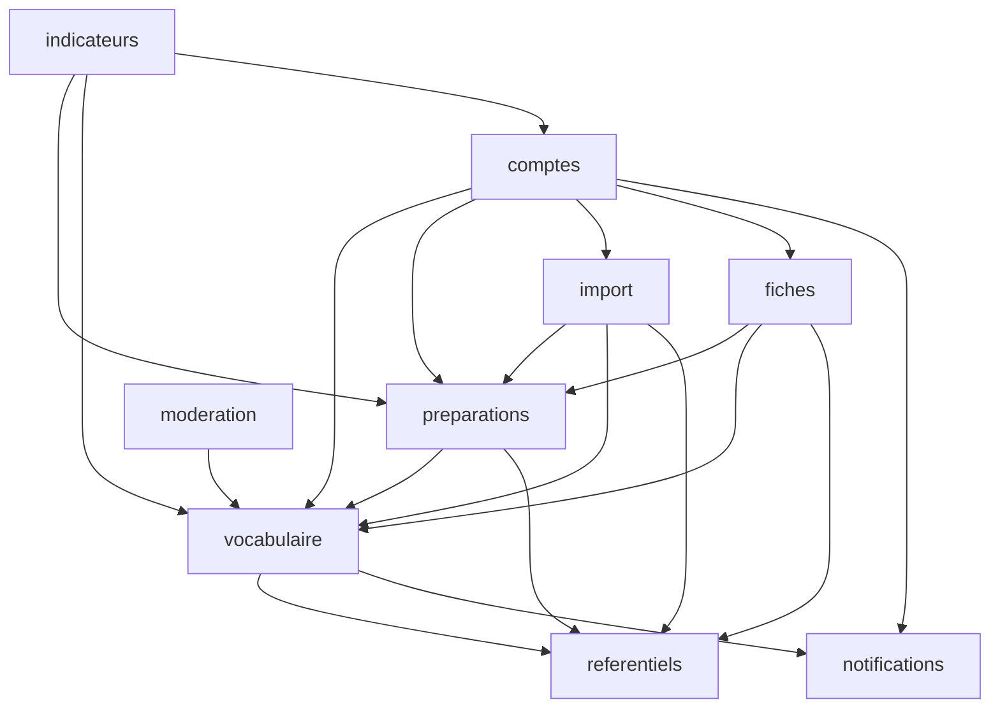

# Revue adversaire — Architecture Spine corpus-mots

## Verdict

Le spine est solide sur le cycle de vie d'une Image, la licence et le contrat front/back. Mais **son graphe de dépendances (AD-1) interdit aux modules qui portent les règles centrales de lire les données dont ces règles ont besoin**. AD-2 (visibilité), AD-3 (abandon, notifications) et FR-15/FR-9 ont besoin des liens Préparation→Image. Or ces liens appartiennent à `preparations`, que `vocabulaire` n'a pas le droit d'appeler. Deux agents qui obéissent au spine vont donc forcément soit créer un cycle, soit dupliquer la règle de visibilité. C'est exactement ce que le spine voulait empêcher. La suppression de compte, la synchronisation Keycloak et les référentiels partagés (fusion d'Albums, Thème « utilisé ») butent sur le même problème. **Le spine n'est pas prêt pour un développement en parallèle par agents** tant que les trous critiques C1 à C4 ne sont pas fermés.

Synthèse : 4 critiques, 10 élevés, 8 moyens, 5 faibles.

| ID | Niveau | Trou | Correctif |
| --- | --- | --- | --- |
| C1 | Critique | AD-2/AD-3 dépendent de `preparation_image`, inaccessible à `vocabulaire` | AD-14 (nouveau) |
| C2 | Critique | Notifications aux collègues qui ont lié l'Image : aucun créateur possible, ou deux | AD-3 resserré + AD-14 |
| C3 | Critique | Suppression de compte : orchestration impossible dans le graphe, échecs Keycloak/BD | AD-6 resserré + AD-18 |
| C4 | Critique | Visible ≠ réutilisable : une Image retirée reste réutilisable ; contournement admin | AD-2 resserré |
| H1 | Élevé | `Enseignant` : UUID `sub` contre `uuidv7()`, deux créateurs, `actif` en double | AD-6 resserré |
| H2 | Élevé | `referentiels` doit connaître ses utilisateurs en aval (Thème utilisé, fusion d'Albums) | AD-15 (nouveau) |
| H3 | Élevé | Nom du propriétaire : `vocabulaire` ne peut pas lire `comptes` | AD-20 (nouveau) |
| H4 | Élevé | Types échangés entre modules (entités ? DTO ?) et collisions de schémas OpenAPI | AD-16 (nouveau) |
| H5 | Élevé | État « à remplacer » : où il est calculé, s'il est copié, ce qu'en font les Fiches | AD-3 + AD-12 resserrés |
| H6 | Élevé | Course à la création Mot/Sens ; propriété des champs partagés de Mot/Sens | AD-19 (nouveau) |
| H7 | Élevé | Unicité sur `forme_normalisee` qui fusionne des mots distincts (côte/côté) | AD-10 resserré |
| H8 | Élevé | AD-4 confond type et licence ; versabilité de `photo_personnelle` contraire à UJ-3 | AD-4 resserré |
| H9 | Élevé | Frontières de transaction entre modules ; appels HTTP en transaction ; reprise de l'Import | AD-17 (nouveau) + AD-11 resserré |
| H10 | Élevé | Course entre suppression et liaison d'une Image (pas de clé étrangère inter-modules) | AD-14 + AD-17 |
| M1 | Moyen | Changer le Sens d'une Image liée dans ses propres Préparations | AD-5 resserré |
| M2 | Moyen | Trous du diagramme d'états (versee→suppression, « liée nulle part », ramasse-miettes) | AD-3 resserré |
| M3 | Moyen | Indicateurs : lecture inter-enseignants, « actif », sémantique d'`origine` | AD-24 (nouveau) |
| M4 | Moyen | Import : choix du Sens, réduction des octets du brouillon, origine | AD-11 resserré |
| M5 | Moyen | Chargement des fichiers image par le navigateur (jeton porteur, ``) | AD-23 (nouveau) |
| M6 | Moyen | Migrations Flyway en parallèle, clés étrangères inter-modules | AD-22 (nouveau) |
| M7 | Moyen | Actions d'admin exposées dans deux modules ; stockage du motif | AD-3 resserré |
| M8 | Moyen | Export de Mes mots (réversibilité) placé dans `vocabulaire`, qui ne voit pas les Préparations | Carte des capacités |
| L1 | Faible | Mots orphelins créés à la frappe | AD-19 |
| L2 | Faible | Historique de Fiche pointant vers une Préparation supprimée | AD-12 resserré |
| L3 | Faible | Contenu des Notifications : `notifications` ne peut pas relire l'Image | AD-3 resserré |
| L4 | Faible | Enseignant invité mais jamais activé, compté comme membre | AD-6 resserré |
| L5 | Faible | Écritures concurrentes sur une Image (verser contre retirer) | AD-17 |

---

## Critiques

### C1 — AD-2 et AD-3 ont besoin des liens Préparation→Image, que `vocabulaire` ne peut pas lire

**Constat.** `PREPARATION_IMAGE` appartient à `preparations`, d'après le modèle de données et la carte des capacités. AD-1 donne l'arête `preparations --> vocabulaire` : l'arête inverse créerait un cycle. Pourtant, `vocabulaire` doit savoir si une Image est liée, et à qui, pour au moins six règles :

- AD-2 : « visible si […] **liée à l'une de ses Préparations** » ; « un Mot n'est révélé que s'il […] **figure dans une Préparation de l'enseignant** » ;
- AD-3 : `privee --> abandonnee` « si liée chez un collègue » contre `privee --> [*]` « liée nulle part » ;
- AD-3 : « toute transition qui touche un autre enseignant crée sa Notification » (il faut savoir qui l'a liée) ;
- FR-15 : dans Mes mots, le filtre Section « retient aussi les Images utilisées dans une Préparation de cette Section » ;
- FR-9 : classement « à Section égale, celles déjà utilisées pour ce Sens dans d'autres Albums » ;
- FR-8 : « les Albums où il apparaît ».

**Unité A — epic « Visibilité et détection » (agent `vocabulaire`).** Pour respecter AD-2 (« seul composant ») sans enfreindre AD-1 (pas d'appel à `preparations`), l'agent ne garde dans `VisibiliteImages` que les deux règles qu'il peut calculer : propriétaire, ou `versee`. Il ajoute une méthode `estVisible(imageId, enseignantId, boolean lieeParAppelant)` et laisse l'appelant fournir la troisième condition.

**Unité B — epic « Préparations » (agent `preparations`).** Pour afficher une Image retirée encore liée (FR-21), l'agent appelle `VisibiliteImages.imagesVisibles(enseignantId)`, qui ne la renvoie plus. Il ajoute donc dans `preparations.service` son propre « si l'Image est liée dans ma Préparation, je l'affiche » et lit le fichier binaire via un nouvel endpoint `/api/preparations/{id}/images/{imageId}/fichier`. Résultat : deux règles de visibilité et deux chemins vers les octets, dont un qui ne passe pas par `VisibiliteImages`.

**Variante encore plus probable.** L'agent A ajoute simplement `vocabulaire --> preparations` « pour la visibilité ». Le cycle `preparations ⇄ vocabulaire` apparaît, CDI le tolère à l'exécution, et personne ne le voit avant le premier `@Transactional` réentrant.

**Correctif — nouvel AD-14 (texte proposé) :**

> ### AD-14 — Registre des usages, propriété de `vocabulaire` [ADOPTED]
>
> - **Binds :** AD-2, AD-3, AD-5, FR-8, FR-9, FR-15, FR-20, FR-21, FR-33, FR-34
> - **Prevents :** une règle de visibilité ou de suppression qui aurait besoin de lire les tables de `preparations` ; deux propriétaires du lien Préparation→Image
> - **Rule :** le lien entre une Préparation et une Image (`lien_image` : `id`, `preparation_id`, `preparation_mot_id`, `image_id`, `enseignant_id`, `album_id`, `section`, `origine`, `cree_le`) et la retenue d'un Sens dans une Préparation (`sens_retenu` : `preparation_id`, `preparation_mot_id`, `sens_id`, `enseignant_id`, `album_id`, `section`) **appartiennent au module `vocabulaire`**. Ils ne se modifient que par `vocabulaire.service.Usages` : `retenirSens`, `lierImage`, `delierImage`, `remplacerImage`, `libererPreparationMot`, `libererPreparation`, `changerContextePreparation(preparationId, albumId, section)`. `preparations` possède `preparation` et `preparation_mot` (ordre, Thème par défaut, renommage) et appelle `Usages` dans la même transaction pour tout ajout, retrait ou duplication. `preparations` ne stocke aucune copie de `image_id` ni de l'état d'une Image. `VisibiliteImages`, les transitions d'AD-3, les notifications aux collègues, le filtre Section de FR-15, le classement de FR-9 et les indicateurs de réutilisation lisent exclusivement ce registre.

Mettre à jour le modèle de données en conséquence : `PREPARATION_IMAGE` devient `LIEN_IMAGE`, dans `vocabulaire`.

### C2 — Notifications « Image Réutilisée retirée de la banque » : aucun créateur possible, ou deux

**Constat.** FR-33 notifie les enseignants qui ont lié une Image quand elle est retirée ou supprimée. AD-3 impose de créer la Notification « dans la même transaction » mais ne désigne aucun créateur. `vocabulaire` est le seul module relié à `notifications`, et il ne sait pas qui a lié l'Image (C1).

**Unité A — story « Retrait par le propriétaire » (agent `vocabulaire`).** L'agent notifie le propriétaire quand c'est l'admin qui agit, et ne notifie personne d'autre, faute de savoir qui a lié l'Image.

**Unité B — story « Préparation : signaler à remplacer » (agent `preparations`).** L'agent remarque que personne ne prévient les collègues. Il ajoute l'arête `preparations --> notifications`, sans cycle, et crée une Notification « retirée » à la première ouverture de la Préparation qui contient une Image non `versee`. C'est la mauvaise transaction, avec un risque de doublon à chaque ouverture.

Pour une retraite admin, on obtient trois chemins de création possibles (vocabulaire, preparations, moderation).

**Correctif — AD-3 resserré (remplacer sa dernière phrase par) :**

> Les `Notification` ne sont créées **que** par `vocabulaire.service`, dans la méthode qui réalise la transition et dans sa transaction, via `notifications.service.creer(...)`. Destinataires : le propriétaire si l'acteur est un administrateur, plus **chaque enseignant distinct, autre que le propriétaire, qui a au moins un `lien_image` vers cette Image** (AD-14), pour les transitions `versee → privee`, `* → abandonnee` et `* → supprimee`. Aucun autre module ne crée de Notification. `notifications` ne dépend que de `commun` et ne relit jamais l'Image (voir L3).

### C3 — Suppression de compte : l'orchestration est impossible dans le graphe et ses échecs partiels ne sont pas définis

**Constat.** AD-6 : « la suppression anonymise `Enseignant`, efface ses Images non versées (non liées ailleurs) et supprime le compte Keycloak ». Mais le compte a aussi des Préparations, des `ImportBrouillon` (avec des octets d'images), des Fiches et des Notifications. Le §6.2 du PRD exige l'effacement. Or `comptes` ne dépend que de `vocabulaire` et `commun`.

**Unité A — story « Supprimer un compte » (agent `comptes`).** L'agent fait exactement ce que dit AD-6 : `vocabulaire.supprimerImagesDe(id)`, anonymisation, puis `keycloak.delete(sub)`. Les Préparations, les brouillons (qui contiennent les scans d'albums) et les Fiches restent en base, au nom d'un « ancien membre de l'équipe ». La demande d'effacement RGPD n'est pas satisfaite.

**Unité B — story « Images d'un compte supprimé » (agent `vocabulaire`).** L'agent calcule « non liées ailleurs » sans tenir compte des Préparations du compte supprimé, qui existent encore. Une Image privée liée uniquement dans les Préparations de son propriétaire devient alors `abandonnee` au lieu d'être effacée, et elle n'est plus jamais supprimée.

**Échecs partiels non traités** (l'ordre « Keycloak puis Enseignant » d'AD-6) :

- Keycloak supprime l'utilisateur, puis la transaction BD échoue : il reste un `Enseignant` actif sans compte, avec ses Images privées, et rien pour reprendre l'opération.
- La BD anonymise, puis `DELETE` Keycloak échoue (Keycloak redémarre, par exemple) : **l'utilisateur peut encore se connecter** et son `sub` retrouve un `Enseignant` anonymisé.

**Correctif — nouvel AD-18 (texte proposé) :**

> ### AD-18 — Opérations de compte : ordre, compensation, reprise [ADOPTED]
>
> - **Binds :** AD-6, FR-1, FR-32, §6.2
> - **Prevents :** un compte Keycloak sans `Enseignant` ou l'inverse ; un effacement RGPD partiel
> - **Rule :** chaque opération de compte suit l'ordre **fermer d'abord, effacer ensuite**.
>   1. *Supprimer* : (a) Keycloak `enabled=false` et révocation des sessions ; (b) une transaction BD unique, ouverte par `comptes.service`, qui passe `Enseignant.statut = suppression_en_cours`, puis appelle dans cet ordre `fiches.service.purgerEnseignant`, `import.service.purgerEnseignant`, `preparations.service.purgerEnseignant` (qui libère ses usages, AD-14), `vocabulaire.service.purgerEnseignant` (règles de FR-32 et d'AD-3, après la libération des usages), `notifications.service.purgerEnseignant`, puis anonymise et passe `statut = supprime` ; (c) Keycloak `DELETE`. Un échec en (c) laisse `statut = supprime` avec un compte Keycloak désactivé : sans risque, et une tâche planifiée de `comptes` réessaie (c) au démarrage puis chaque heure.
>   2. *Inviter* : `Enseignant` est créé en BD avec `statut = invite`, dans la transaction qui suit l'appel Keycloak réussi ; si la transaction échoue, `comptes.service` supprime l'utilisateur Keycloak créé (compensation). Si la compensation échoue, la tâche planifiée supprime tout utilisateur Keycloak du realm sans `Enseignant`.
>   3. *Désactiver / réactiver / changer de rôle* : Keycloak d'abord, BD ensuite ; la tâche planifiée resynchronise les champs copiés depuis Keycloak (voir H1).
>
>   Aucun appel HTTP à Keycloak n'a lieu pendant une transaction BD ouverte (AD-17). Le graphe d'AD-1 reçoit les arêtes `comptes --> preparations`, `comptes --> import`, `comptes --> fiches`, `comptes --> notifications`.

Vérification du graphe : aucun de ces modules ne dépend de `comptes`, sauf `indicateurs`, qui reste en aval. Pas de cycle.

### C4 — Visible n'est pas réutilisable : une Image retirée se ré-attache, et l'admin a un passe-droit implicite

**Constat.** AD-2 ne définit qu'un seul prédicat : visible si propriétaire, ou `versee`, ou liée à une de ses Préparations. FR-21 dit d'une Image retirée qu'« elle ne peut plus être Réutilisée ». Mais d'après AD-2, elle **reste visible** pour quiconque l'a liée, y compris dans la détection, les filtres et la Banque, puisque AD-2 range « détection, Banque, filtres » sous la même règle.

**Unité A — epic « Détection » (agent `vocabulaire`).** La détection renvoie « les Images que l'enseignant voit » au sens d'AD-2. Claire a lié l'Image de Paul, que Paul a retirée. Quand elle tape « farine » dans une nouvelle Préparation, l'Image retirée lui est proposée. Elle la réutilise, et un nouveau `lien_image` est créé vers une Image privée de Paul. FR-21 est violé, et la confidentialité de Paul aussi : il a retiré l'Image et elle continue de se propager.

**Unité B — epic « Modération » (agent `moderation`).** Pour supprimer une Image `abandonnee` (transition `abandonnee --> supprimee` d'AD-3), l'admin doit la voir. L'agent ajoute à `VisibiliteImages` « ou l'enseignant a le rôle `admin` ». Ce n'est qu'une condition de plus dans le composant unique, donc AD-2 est respecté. Résultat : **l'admin voit toutes les Images privées de toute l'école**, y compris dans Mes mots et les filtres, puisque c'est le même prédicat. C'est la fuite FR-8 que AD-2 devait empêcher.

Autre fuite : FR-8 affiche « les Albums où il apparaît ». Un agent qui les calcule à partir des Préparations des collègues (même via AD-14) révèle les Albums travaillés en privé, ce que FR-8 interdit explicitement.

**Correctif — AD-2 resserré (texte de remplacement de la règle) :**

> `vocabulaire.service.VisibiliteImages` est le seul composant qui décide de ce qu'un enseignant voit. Il expose **trois prédicats nommés**, et aucun autre :
> - `consultable(image, enseignant)` : il en est propriétaire et l'état n'est pas `abandonnee`/`supprimee` ; ou l'état est `versee` ; ou il a un `lien_image` vers elle (AD-14), dans quel cas elle n'est montrée **que dans la Préparation qui la lie** et dans ses Fiches.
> - `proposable(image, enseignant)` (détection, FR-7, FR-9, Banque, filtres, Fiches par filtre) : il en est propriétaire et l'état est `privee` ou `versee` ; ou l'état est `versee`. **Un lien ne rend jamais une Image proposable.**
> - `moderable(image)` (réservé à `moderation`) : l'état est `versee` ou `abandonnee`. Il ne sert qu'aux écrans de modération et ne renvoie jamais de Carte d'identité d'Image `privee`.
>
> Le rôle `admin` n'élargit aucun autre prédicat. Les Albums montrés par la détection (FR-8) sont l'album d'origine des Images `proposable`, plus les Albums des Préparations **de l'enseignant lui-même** ; jamais ceux des Préparations d'un collègue. Le `GET` binaire applique `consultable` ou `moderable` selon le rôle et la ressource appelée.

---

## Élevés

### H1 — `Enseignant` : identifiant contradictoire, deux créateurs possibles, état `actif` en double

**Constat.** AD-6 : « UUID = `sub` Keycloak ». Les conventions : « UUID partout (générés par la base, `uuidv7()`) ». AD-6 garde aussi `actif` dans `Enseignant`, alors que Keycloak a `enabled` et possède le rôle `admin`.

**Unité A — story « Invitation » (agent `comptes`).** L'agent suit les conventions : `enseignant.id DEFAULT uuidv7()`, plus une colonne `keycloak_sub`.

**Unité B — story « Enseignant courant » (agent `commun`).** L'agent suit AD-6 : `EnseignantCourant.id()` renvoie le `sub` du jeton. Il est utilisé comme `proprietaire_id` des Images. Aucune Image n'appartient alors à un `enseignant.id` existant : les noms des propriétaires, la suppression de compte et les indicateurs sont tous faux.

**Variante.** Un agent qui doit fournir « l'enseignant courant » rencontre un `sub` sans `Enseignant` (C3, invitation à moitié faite) et crée l'`Enseignant` à la volée. On a alors deux créateurs d'`Enseignant`, dont un dans `commun`, qui « ne dépend de rien » et n'a pas de table.

**Correctif — AD-6 resserré (ajouter) :**

> `enseignant.id` **n'est pas** généré par la base : c'est le `sub` du compte Keycloak, fourni par `comptes.service` à la création. C'est la seule exception à la convention `uuidv7()`. Seul `comptes.service` insère dans `enseignant`, et uniquement lors de l'invitation (AD-18) ; il n'y a aucun provisionnement à la volée. Une requête authentifiée dont le `sub` n'a pas d'`Enseignant` au statut `actif` reçoit `403` avec le `code` `compte.inconnu_ou_inactif` (contrôle fait par un filtre de `comptes`, exposé à `commun` sous forme d'interface `commun.EnseignantCourant`). `Enseignant.statut` (`invite`, `actif`, `desactive`, `suppression_en_cours`, `supprime`) est une copie de l'état Keycloak, écrite **seulement** par `comptes.service` après le succès de l'appel Keycloak ; en cas de divergence, Keycloak fait foi. Le rôle `admin` n'est jamais copié en base : il se lit dans le jeton. La règle « au moins un administrateur » se vérifie en interrogeant Keycloak, et les changements de rôle sont sérialisés par un verrou consultatif PostgreSQL (`pg_advisory_xact_lock`) pris par `comptes.service`.

### H2 — `referentiels` doit connaître ses utilisateurs en aval

**Constat.** FR-5 : « un Thème utilisé ne peut pas être supprimé sans réaffecter ses Images ». FR-4 : « l'administrateur peut fusionner deux Albums ». La suppression d'un Module suit la même logique. `image_theme`, `image.album_id`, `preparation.album_id`, les sources de Fiches et les brouillons d'import appartiennent tous à des modules qui dépendent de `referentiels`. `referentiels` ne peut appeler aucun d'eux.

**Unité A (agent `referentiels`).** L'agent fusionne deux Albums en mettant à jour ses propres tables et supprime l'Album B. Toutes les Images et Préparations qui référencent B par UUID pointent dans le vide. AD-1 interdit les relations JPA, donc personne n'a posé de contrainte.

**Unité B (agent `vocabulaire`).** L'agent ajoute un endpoint `DELETE /api/themes/{id}` dans `vocabulaire.api`, parce qu'il « sait si le Thème est utilisé ». On a deux endpoints de suppression de Thème et deux propriétaires de fait.

**Correctif — nouvel AD-15 (texte proposé) :**

> ### AD-15 — Remonter le graphe : événements synchrones déclarés en amont [ADOPTED]
>
> - **Binds :** AD-1, FR-4, FR-5
> - **Prevents :** une arête inverse ; un module amont qui modifie les données d'un module aval
> - **Rule :** quand un module amont doit consulter ses utilisateurs ou les prévenir (fusion d'Albums, suppression d'un Module ou d'un Thème), il **déclare** dans son paquetage `service` une interface `…Utilisation` (« est-ce utilisé ? ») ou un événement (`AlbumsFusionnes(source, cible)`, `ModuleSupprime`, `ThemeSupprime`). Les modules aval implémentent l'interface ou observent l'événement avec `@Observes` **synchrone**, dans la transaction de l'émetteur. `@ObservesAsync`, les files de messages et `TransactionPhase.AFTER_*` sont interdits pour toute règle de cohérence. Seul le module propriétaire expose l'endpoint de suppression ou de fusion de son entité. C'est le seul mécanisme autorisé pour remonter une arête d'AD-1.

### H3 — Nom du propriétaire : `vocabulaire` ne peut pas lire `comptes`

**Constat.** FR-18 : « voit toujours à qui appartient chaque Image ». FR-15 filtre par propriétaire. Pour une Image, `vocabulaire` doit renvoyer le nom du propriétaire, mais `comptes --> vocabulaire` interdit l'inverse.

**Unité A (agent `vocabulaire`).** Il ajoute une colonne `proprietaire_nom` à `image`, copiée au moment de la création. Quand l'enseignant change son nom affiché, ou quand son compte est anonymisé (« ancien membre de l'équipe », AD-6), cette copie devient fausse, et le nom réel reste dans la base après l'effacement RGPD.

**Unité B (agent front `banque`).** Il attend `proprietaireNom` dans le DTO généré, mais l'agent `fiches`, qui ne connaît que `proprietaireId`, lui envoie un autre DTO.

**Correctif — nouvel AD-20 (texte proposé) :**

> ### AD-20 — Annuaire des enseignants [ADOPTED]
>
> - **Rule :** le nom affiché d'un enseignant n'est stocké que dans `enseignant` (module `comptes`). Les autres modules ne stockent et ne renvoient que `proprietaireId` / `enseignantId`. Le front résout les noms par `GET /api/enseignants` (`comptes.api`, accessible à tout enseignant, renvoie seulement `id`, `nomAffiche`, `statut`, y compris les comptes anonymisés), mis en cache dans un service à signals `commun/annuaire`. Le filtre « propriétaire » de FR-15 prend un identifiant. Les exports (Fiches) qui citent un auteur utilisent le champ `auteur` de la Carte d'identité, jamais le nom du propriétaire.

### H4 — Types échangés entre modules et collisions de schémas OpenAPI

**Constat.** AD-1 rend la persistance privée, mais rien ne dit ce que renvoie une méthode publique d'un `service`. AD-7 génère le client depuis l'OpenAPI, et SmallRye nomme les schémas d'après le **nom simple** de la classe.

**Unité A (agent `vocabulaire`).** `ImageService.trouver(id)` renvoie l'entité `Image`, ce qui est pratique et n'enfreint aucune règle écrite. L'agent `fiches` lit `image.getFichier().getOctets()` hors transaction : `LazyInitializationException`, ou alors l'agent `fiches` ajoute un `@Transactional` qui charge 30 fichiers pleine résolution par une association que `fiches` n'a pas le droit de connaître.

**Unité B (agents `vocabulaire` et `preparations`).** Chacun crée `api/ImageDto` dans son module, avec des champs différents (`etat` d'un côté, `aRemplacer` de l'autre). L'OpenAPI ne garde qu'un seul schéma `ImageDto`, et le client TypeScript généré est faux pour l'un des deux écrans, **sans erreur de compilation**.

**Correctif — nouvel AD-16 (texte proposé) :**

> ### AD-16 — Ce qui traverse une frontière [ADOPTED]
>
> - **Rule :** une méthode publique de `service` appelée par un autre module accepte et renvoie uniquement des `record` immuables déclarés dans `fr.corpusmots.<module>.service` (suffixe `Vue` ou `Commande`), jamais une entité, un `Repository` ou un DTO de la couche `api`. Les octets d'une Image ne traversent une frontière que par `vocabulaire.service.FichiersImages.lire(imageId, enseignantId, usage)`, qui applique AD-2. Les DTO REST portent un nom **unique dans tout le back** (préfixe du module si nécessaire : `PreparationImageDto`, `BanqueImageDto`), et le build échoue si deux classes exposées dans l'OpenAPI ont le même nom simple (test d'architecture ArchUnit). La représentation d'une Image dans une réponse REST, où qu'elle soit, contient toujours `id`, `proprietaireId`, `etat`, `aRemplacer` (`null`, `retiree`, `supprimee`) et `reutilisable`, calculés par `vocabulaire` (voir H5).

Ajouter dans « Tests » : un test ArchUnit qui vérifie AD-1 (graphe), AD-16 et l'absence d'entités d'un autre module dans les imports.

### H5 — État dérivé « à remplacer » : qui le calcule, qui le copie, et ce qu'en font les Fiches

**Constat.** AD-3 : « état dérivé, non stocké ». Mais `preparations` doit l'afficher (FR-21, FR-31), et `fiches` doit décider quoi faire d'une Image retirée ou supprimée quand on « refait en un clic » (AD-12). FR-21 dit que « les Fiches déjà exportées ne sont pas affectées », mais AD-12 **régénère** toujours.

**Unité A (agent `preparations`).** Pour éviter un appel N+1 par Image, il ajoute une colonne `etat_image` dans `preparation_image`, mise à jour… par personne, car `vocabulaire` ne connaît pas `preparations`. L'affichage « à remplacer » n'apparaît jamais.

**Unité B (agent `fiches`).** À la régénération, il passe par `VisibiliteImages` (AD-2), qui renvoie aussi les Images liées retirées : il les imprime. Pour une Image `supprimee`, il n'y a plus de fichier, donc `NullPointerException`, ou bien l'Image est sautée sans prévenir et l'enseignant perd un Mot sur sa planche.

**Correctif — AD-3 resserré (ajouter) :**

> L'état « à remplacer » se calcule uniquement dans `vocabulaire.service`, à la lecture, à partir de `etat` et du lien (AD-14) : `retiree` si l'Image n'est pas `versee` et que le lecteur n'en est pas propriétaire, `supprimee` si l'état est `supprimee`. Il est renvoyé dans la `Vue` (AD-16) et **n'est jamais copié** dans une autre table. `vocabulaire` fournit une lecture groupée (`vuesPourPreparation(preparationId, enseignantId)`) pour éviter le N+1.

**Et AD-12 resserré (ajouter) :**

> À la génération, une Image `retiree` liée dans la Préparation source est incluse (elle reste `consultable`, AD-2). Une Image `supprimee` est remplacée par un cadre vide légendé « image supprimée » et signalée dans la réponse (`avertissements`). Une Fiche par filtre ne contient que des Images `proposable`. « Les Fiches déjà exportées ne sont pas affectées » signifie que les fichiers déjà téléchargés ne changent pas, **pas** que « refaire » reproduit l'ancien contenu.

### H6 — Mot et Sens : course à la création, Sens cachés en double, champs partagés sans propriétaire

**Constat.** Le Mot est unique par `forme_normalisee` (AD-10). AD-2 présente comme « nouveau » un Mot qui n'existe que dans Mes mots d'un collègue. Rien ne dit qui crée le Mot, comment se règle une création simultanée, ce qui arrive aux Sens cachés, ni qui peut modifier l'article, le genre ou la catégorie grammaticale d'un Sens (la Carte d'identité les contient, FR-14).

**Unité A (agent `preparations`, saisie en série).** Paul tape « four », que la détection présente comme nouveau parce qu'il n'existe que chez Claire. Le front appelle `POST /api/mots`, et `vocabulaire` fait un `INSERT` qui viole la contrainte unique. L'agent renvoie `409` avec le Mot existant, ce qui lui révèle le Sens privé de Claire (« four (cuisine) »), son article, et le fait que quelqu'un l'a créé : fuite FR-8. Dans une autre version, il crée un **second Sens** « four », identique et caché ; quand Claire versera son Image, Paul verra deux Sens « four ».

**Unité B (agent `vocabulaire`, Carte d'identité).** Comme « seul le propriétaire modifie la Carte d'identité » (AD-5) et que la catégorie grammaticale vit sur le Sens (FR-10), l'agent laisse le propriétaire d'une Image modifier la catégorie de **son** Sens. Ce Sens est partagé : la Carte d'identité des Images de Claire change, ce que FR-22 interdit (« aucune action d'un enseignant ne modifie une Image d'un autre »).

Deux saisies simultanées de « citrouille » par l'import (agent `import`) et la saisie téléphone (agent `photo`) donnent une erreur 500 sur l'une des deux.

**Correctif — nouvel AD-19 (texte proposé) :**

> ### AD-19 — Mot et Sens : créés par une seule porte, partagés sans propriétaire [ADOPTED]
>
> - **Binds :** AD-2, AD-10, FR-8, FR-10, FR-14, FR-22, FR-24
> - **Rule :** Mots et Sens ne se créent que par `vocabulaire.service.Lexique.obtenirOuCreerMot(saisie)` et `obtenirOuCreerSens(motId, libelle, categorie)`. Ces méthodes sont idempotentes (`INSERT … ON CONFLICT DO NOTHING`, puis relecture), ne lèvent jamais d'erreur de doublon et ne renvoient au demandeur que ce qu'AD-2 l'autorise à voir. Un Sens dont le libellé normalisé (AD-10) égale celui d'un Sens existant du même Mot est **réutilisé en silence**, même s'il est caché. Il n'est jamais renvoyé avec plus d'informations que celles saisies par le demandeur. Un Mot ou un Sens n'est créé qu'à l'enregistrement d'un `preparation_mot`, d'une Image ou d'une paire d'Import validée, jamais pendant la détection. Mot (forme, article, genre) et Sens (libellé, catégorie grammaticale) **n'ont pas de propriétaire** et sont **non modifiables en V1** par les enseignants. Une correction passe par l'administrateur (`moderation`) et ne change que l'orthographe ou la catégorie, jamais le rattachement d'une Image. Le libellé affiché d'un Mot est celui de sa première saisie.

### H7 — L'unicité sur `forme_normalisee` fusionne des mots différents, et l'article est mal délimité

**Constat.** AD-10 rend unique la forme « minuscules, sans accents ». En français, cela fusionne des mots distincts : *côte / côté / cote*, *pêche / pèche*, *mûr / mur*, *pâté / pâte* (tous deux `pate`). Comme le Mot est unique et sa forme affichée est celle de la première saisie (H6), l'Image de « côté » se retrouve rattachée au Mot « côte ».

Par ailleurs, l'apostrophe des fichiers Word et PowerPoint est souvent typographique (`l’arbre`, U+2019), et AD-10 ne cite que `l'`. Enfin, `la` sans délimiteur supprime le début de *lapin* ou *lait*.

**Unité A (agent `import`).** Il normalise avec la fonction unique, qui ne connaît pas `’`. « l’arbre » importé devient un nouveau Mot distinct de « arbre ».

**Unité B (agent `vocabulaire`).** Il implémente la regex `^(le|la|l'|les|un|une|des)` sans exiger d'espace après. « lapin » devient « pin ».

**Correctif — AD-10 resserré (texte de remplacement) :**

> Chaque Mot stocke `forme` (première saisie, sans article), `forme_cle` = minuscules NFC **avec accents**, sans article initial, **unique dans l'école**, et `forme_recherche` = `unaccent(forme_cle)`, **non unique**, indexée `pg_trgm`. L'article initial reconnu est `le|la|les|un|une|des` **suivi d'une espace**, ou `l` suivi de `'` ou `’` (U+2019). Les espaces sont réduites et rognées, et les deux apostrophes sont unifiées en `'` avant tout traitement. La détection (FR-8) cherche sur `forme_recherche`, de sorte que « cote » propose « côte » **et** « côté » comme deux Mots distincts. Une seule fonction `Lexique.normaliser` sert à la saisie, à l'import et à la recherche, et un jeu de tests partagé fixe ces cas (côte/côté, l’arbre, lapin, des).

### H8 — AD-4 confond type et licence, et refuse implicitement de verser `photo_personnelle`, contrairement à UJ-3

**Constat.** AD-4 : « Les licences forment une liste fermée : …, plus `photo_personnelle` et `image_album` non versables par type. » Cette phrase se lit de deux façons. Soit ce sont deux valeurs de licence en plus, soit ce sont deux types d'image. Et elle dit que `photo_personnelle` n'est pas versable, alors qu'UJ-3 la verse (« il verse la photo dans la Banque de l'école »). L'énumération des **types** (FR-13 : image d'album, image libre, photo personnelle, inconnu) n'est jamais écrite.

**Unité A (agent `vocabulaire`, verser).** Il refuse de verser `photo_personnelle`, en citant AD-4. UJ-3 est cassé.

**Unité B (agent `import`, saisie en lot).** Il propose dans la liste des licences `photo_personnelle` et `image_album`, et dans la liste des types `image_libre_arasaac`, comme l'écran UJ-2 (« image libre, ARASAAC »). Le versement compare des valeurs qui n'existent pas dans l'autre énumération.

**Correctif — AD-4 resserré (texte de remplacement de la dernière phrase) :**

> Deux énumérations fermées, distinctes : `type_image` = `image_album`, `image_libre`, `photo_personnelle`, `inconnu` ; `licence` = `arasaac_cc_by_nc_sa`, `sclera_cc_by_nc`, `mulberry_cc_by_sa`, `cc0_domaine_public`, `pixabay`, `autre_inconnue`, `droits_auteur_enseignant` (pour `photo_personnelle`, posée automatiquement), `usage_pedagogique_album` (pour `image_album`, posée automatiquement). Versable si et seulement si : `type_image = image_libre` avec `source` non vide et `licence` parmi les quatre premières ; ou `type_image = photo_personnelle`. Tout autre cas est refusé avec un `code` stable par motif (`image.versement.image_album`, `.type_inconnu`, `.licence_non_versable`, `.source_manquante`). Le front et l'import n'ont pas leur propre liste : ils lisent ces énumérations dans le client généré.

### H9 — Frontières de transaction entre modules et appels HTTP pendant une transaction

**Constat.** Les conventions disent « une requête qui modifie = une transaction ouverte dans la couche `service` ». Mais quand `preparations.service` appelle `vocabulaire.service`, les **deux** sont des couches `service` : laquelle ouvre la transaction ? AD-3 exige que la Notification soit créée dans la même transaction, sans interdire `REQUIRES_NEW`. Les appels à ARASAAC (AD-9) et à Keycloak (AD-6) sont des appels réseau.

**Unité A (agent `notifications`).** Il annote `creer` avec `@Transactional(REQUIRES_NEW)`, pour qu'une erreur de notification ne fasse pas échouer un retrait. Si le retrait échoue ensuite, la notification est déjà validée : « votre image a été retirée » alors qu'elle ne l'a pas été.

**Unité B (agent `import`).** La validation d'un import de 80 paires appelle `vocabulaire.creerImage` 80 fois. L'agent ouvre une transaction par paire pour pouvoir reprendre l'import (FR-25). Si le serveur tombe à la paire 41, 40 Images existent mais le brouillon ne le sait pas. À la reprise, 40 Images sont créées en double. L'agent `vocabulaire`, lui, télécharge le pictogramme ARASAAC **dans** la transaction : une connexion BD reste bloquée pendant la latence d'ARASAAC.

**Correctif — nouvel AD-17 (texte proposé) :**

> ### AD-17 — Transactions [ADOPTED]
>
> - **Rule :** la transaction est ouverte par la méthode de `service` **du module dont la ressource REST a reçu la requête** ; toute méthode de `service` appelée par un autre module est `@Transactional(REQUIRED)` et rejoint cette transaction. `REQUIRES_NEW`, `@ObservesAsync` et toute écriture hors de la transaction de la requête sont interdits, sauf pour les tâches planifiées d'AD-18. Aucun appel HTTP sortant (ARASAAC, Keycloak) n'a lieu pendant une transaction ouverte : on télécharge ou on appelle d'abord, on écrit ensuite (et on compense en cas d'échec, AD-18). Une Image porte une colonne `@Version` (verrouillage optimiste) ; `lierImage` et toute transition d'AD-3 prennent `SELECT … FOR UPDATE` sur la ligne `image`.

**Et AD-11 resserré (ajouter) :**

> La validation d'un `ImportBrouillon` est **une seule transaction**. Chaque paire du brouillon porte une clé d'idempotence (`paire_id`), stockée sur l'Image créée (`image.import_paire_id`, unique) ; une validation rejouée ne recrée pas une Image existante. Le brouillon passe à l'état `valide` dans la même transaction. Si le volume dépasse la limite de taille de transaction fixée dans la story, la validation se fait par lots, chacun idempotent par `paire_id`.

### H10 — Course entre suppression et liaison : un lien peut pointer vers une Image effacée

**Constat.** AD-1 interdit les relations JPA entre modules et ne dit rien des contraintes SQL. `privee --> [*]` (suppression physique « si liée nulle part ») et la liaison par un collègue peuvent se croiser.

**Unité A (agent `vocabulaire`, suppression).** Il lit « liée nulle part ? Oui », puis fait `DELETE`.

**Unité B (agent `preparations`, réutiliser).** Il lit « Image visible ? Oui » (elle est `versee`), puis fait `INSERT preparation_image`. Les deux s'entrelacent sous `READ COMMITTED`, et il reste un lien vers une Image inexistante. Avec un `versee → privee` concurrent, on obtient aussi une réutilisation d'une Image qui vient d'être retirée, sans notification.

**Correctif :** AD-14 met le lien dans le même module que l'Image, ce qui permet une vraie clé étrangère `lien_image.image_id → image.id`. AD-17 impose `SELECT … FOR UPDATE` sur `image` dans `lierImage`, `supprimer`, `verser` et `retirer`. Ajouter à AD-14 :

> `lien_image.image_id` porte une clé étrangère SQL vers `image.id` (même module). `lierImage` vérifie `proposable` (AD-2) **après** avoir verrouillé la ligne `image`.

---

## Moyens

### M1 — Changer le Sens d'une Image liée dans ses propres Préparations

AD-5 n'interdit le changement de Sens que pour une Image « liée chez un collègue ». **Unité A** (`vocabulaire`, Carte d'identité) : Paul déplace son Image de « étalé (cuisine) » vers « étalé (chute) ». **Unité B** (`preparations`) : le `preparation_mot` de Paul vise toujours « étalé (cuisine) », mais illustré par une Image d'un autre Sens. La Fiche imprime l'image de la chute sous le mot de cuisine.

**AD-5 resserré (ajouter) :**

> Le Sens d'une Image ne change que si elle n'a **aucun** `lien_image`, chez quiconque, propriétaire compris. Sinon, le propriétaire doit ajouter une nouvelle Image. Invariant vérifié par `vocabulaire` : pour tout `lien_image`, `image.sens_id = sens_retenu.sens_id` du `preparation_mot` concerné.

### M2 — Trous du diagramme d'états d'AD-3

- Pas de transition `versee --> [*]` : le propriétaire qui supprime une Image versée liée nulle part. Un agent refuse, un autre la retire d'abord puis la supprime, un troisième ajoute la transition.
- « Liée nulle part » : les Préparations du propriétaire comptent-elles ? Un agent supprime physiquement et laisse les liens du propriétaire pendants ; un autre bascule en `abandonnee` une Image liée seulement chez son propriétaire, qui ne la voit alors plus du tout.
- Une Image `abandonnee` dont le dernier lien disparaît reste en base pour toujours, y compris pour un compte supprimé (RGPD).
- Un propriétaire peut reverser immédiatement une Image que l'admin vient de retirer avec le motif « licence non conforme ».
- Une Image versée d'un compte supprimé (« ancien membre »), retirée par l'admin, devient `privee` pour un propriétaire qui n'existe plus : un orphelin invisible.

**AD-3 resserré (ajouter) :**

> « Liée chez un collègue » = au moins un `lien_image` dont `enseignant_id ≠ proprietaire_id`. Suppression par le propriétaire depuis `privee` **ou `versee`** : ses propres liens sont supprimés dans la même transaction, puis l'Image passe à `abandonnee` si un lien de collègue subsiste, sinon elle est effacée physiquement. Quand le dernier `lien_image` d'une Image `abandonnee` est supprimé, `vocabulaire` l'efface physiquement dans la même transaction. Un retrait admin enregistre `retrait_admin_motif` ; tant qu'il est renseigné, `verser` est refusé (`image.versement.retrait_admin`) jusqu'à ce que le propriétaire modifie la Carte d'identité. Pour un propriétaire au statut `supprime`, le retrait admin équivaut à la suppression par le propriétaire.

### M3 — Indicateurs : lecture inter-enseignants, « actif », sens d'`origine`

`indicateurs` dépend des services, mais toutes les méthodes publiques filtrent par enseignant (AD-2). **Unité A** (`indicateurs`) contourne en écrivant des vues SQL natives sur `image` et `preparation_image`, ce qui viole AD-1 sans que personne ne s'en aperçoive. **Unité B** (`vocabulaire`) expose `toutesLesImages()` « pour les indicateurs », une méthode sans visibilité qu'un autre agent réutilisera dans un écran.

« Enseignants actifs par mois » (FR-34) et « inactif depuis un an » (FR-32) n'ont pas de source : événements Keycloak ou horodatage applicatif ? Et `origine` est indéfini pour une Préparation dupliquée, une Image importée et rattachée à une Préparation, ou une Image du propriétaire réutilisée l'année suivante. Or SM-5 veut distinguer « réutilisée d'un collègue ».

**Nouvel AD-24 (texte proposé) :**

> ### AD-24 — Indicateurs [ADOPTED]
>
> - **Rule :** `indicateurs` ne lit que des méthodes d'agrégat dédiées, déclarées par chaque module dans un `service.Statistiques…` qui ne renvoie que des comptes et des taux, jamais d'identifiant d'Image ni de Carte d'identité. Activité : `comptes` enregistre `enseignant_activite(enseignant_id, mois)` au premier appel authentifié du mois (filtre de `comptes`, sans appel à Keycloak). `origine` est fixée par `Usages.lierImage` : `nouvelle` si l'Image a été créée dans la même transaction ou par l'Import qui alimente cette Préparation ; sinon `reutilisee`. Une duplication de Préparation copie les liens avec `origine = reutilisee`. Le taux de réutilisation = liens `reutilisee` ÷ `preparation_mot` illustrés, par Album ; « réutilisée d'un collègue » se calcule avec `image.proprietaire_id ≠ lien_image.enseignant_id`.

### M4 — Import : choix du Sens, octets du brouillon, origine

**Unité A** (`import`) stocke les images extraites en pleine résolution dans `import_paire.octets` et les réduit elle-même avant l'appel, avec une deuxième implémentation de la réduction d'AD-8. **Unité B** (`vocabulaire`) les réduit de nouveau, avec un autre algorithme et une perte cumulée. Pour un Mot existant à plusieurs Sens, l'import choisit le premier Sens en silence, alors que FR-24 dit que « la détection de FR-8 s'applique ».

**AD-11 resserré (ajouter) :**

> Chaque paire du brouillon stocke explicitement `sens_choisi` : l'identifiant d'un Sens `proposable`, ou « nouveau Sens » avec son libellé. Il n'y a jamais de choix implicite : une paire dont le Mot a plusieurs Sens visibles est signalée « Sens à choisir ». Le brouillon stocke les octets réduits par `vocabulaire.service.ReductionImages`, seule implémentation d'AD-8, appelée au dépôt. Un rattachement à une Préparation passe par `preparations.service`, puis `Usages.lierImage(origine = nouvelle)`.

### M5 — Chargement des fichiers image dans le navigateur

AD-7 interdit les appels HTTP « écrits à la main », et le back exige un jeton porteur à chaque requête. Or une balise `` n'envoie pas d'en-tête `Authorization`. **Unité A** (front `banque`) passe le jeton en paramètre d'URL `?access_token=` (quarkus-oidc peut l'accepter), et le jeton se retrouve dans les journaux de Caddy, ce qui viole la convention « Journaux ». **Unité B** (front `preparations`) charge les octets par le client généré, en `Blob`, avec une requête par image. Pour 500 Images en pleine résolution « impression », l'objectif de 2 s (§5) n'est pas tenu, puisque `IMAGE_FICHIER` n'a qu'une taille.

**Nouvel AD-23 (texte proposé) :**

> ### AD-23 — Fichiers image côté navigateur [ADOPTED]
>
> - **Rule :** `IMAGE_FICHIER` stocke deux tailles : `octets` (taille AD-8) et `miniature` (≤ 256 px, calculée par `ReductionImages`). Le front ne charge une image que par le client généré (`responseType: blob`) et l'affiche via `URL.createObjectURL`, avec une directive partagée `commun/image-securisee` ; aucun jeton dans une URL. Les listes demandent `?taille=miniature`. Les réponses portent `Cache-Control: private, max-age=86400` et un `ETag` égal à l'identifiant de version du fichier.

### M6 — Migrations Flyway en parallèle, clés étrangères inter-modules

Deux agents créent chacun `V7__…sql` dans le dossier commun, et Flyway refuse de démarrer, ou pire, l'un des deux écrase l'autre lors de la fusion. Un agent pose une clé étrangère SQL `preparation.album_id → album.id` (AD-1 n'interdit que les relations JPA), et la fusion d'Albums (H2) échoue alors sur la contrainte. Un autre agent n'en met aucune.

**Nouvel AD-22 (texte proposé) :**

> ### AD-22 — Migrations [ADOPTED]
>
> - **Rule :** une migration s'appelle `V<AAAAMMJJHHMM>__<module>_<objet>.sql` et ne touche que les tables de son module. Les clés étrangères SQL sont obligatoires **à l'intérieur** d'un module et interdites **entre** modules ; l'intégrité inter-modules est assurée par les services (AD-14, AD-15, AD-18). Flyway tourne avec `outOfOrder=false` et `validateOnMigrate=true` ; une migration publiée n'est jamais modifiée.

### M7 — Actions d'administration exposées dans deux modules ; stockage du motif

**Unité A** (`vocabulaire`) ajoute `POST /api/images/{id}/retrait` avec un contrôle `@RolesAllowed("admin")` lorsque l'acteur n'est pas propriétaire, ce qui suffit à respecter AD-3 (« admin avec motif »). **Unité B** (`moderation`) expose `POST /api/moderation/images/{id}/retrait`. On a deux endpoints, deux validations du motif, et l'un des deux n'est pas couvert par les tests de modération.

**AD-3 resserré (ajouter) :**

> Les actions d'administrateur sur une Image (retirer avec motif, supprimer) sont exposées **uniquement** par `moderation.api` ; `vocabulaire.api` n'expose que les actions du propriétaire. Les méthodes de `vocabulaire.service` prennent un `Acteur` explicite (`Proprietaire(id)` ou `Administrateur(id, motif)`). Le motif est une énumération (`licence_non_conforme`, `image_album`, `image_inadaptee`, `autre`) avec un texte libre obligatoire pour `autre`, stocké sur l'Image (`retrait_admin_motif`, `retrait_admin_texte`) et recopié dans la Notification.

### M8 — L'export de Mes mots (réversibilité) est placé dans `vocabulaire`

La carte des capacités place l'« export de Mes mots » dans `vocabulaire`. Mais Mes mots contient aussi les Préparations (Glossaire), que `vocabulaire` ne peut pas lire. Un agent exporte les Images seules, un autre ajoute `vocabulaire --> preparations`.

**Correctif (carte des capacités) :** placer « NFR réversibilité » dans `preparations` (qui dépend déjà de `vocabulaire` et de `referentiels`), en assemblant les Images (`FichiersImages.lire`) et les Préparations dans une archive ZIP (JSON + fichiers).

---

## Faibles

### L1 — Mots orphelins créés à la frappe

Si la détection crée un Mot pour pouvoir proposer ARASAAC, chaque faute de frappe laisse un Mot sans Sens. C'est couvert par AD-19 (« jamais pendant la détection »).

### L2 — Historique de Fiche dont la Préparation source a été supprimée

« Refaire en un clic » sur une Fiche dont la Préparation n'existe plus mène à une erreur 404 ou 500 selon l'agent. **AD-12 resserré (ajouter) :** « la suppression d'une Préparation émet `PreparationSupprimee` (AD-15), et `fiches` marque les Fiches concernées `source_disponible = false` ; le front masque “refaire” pour elles. » Cela ajoute un événement déclaré dans `preparations` et observé par `fiches`, ce qui respecte l'arête `fiches --> preparations`.

### L3 — Contenu des Notifications

`notifications` ne peut pas relire l'Image (sinon `notifications --> vocabulaire` crée un cycle avec `vocabulaire --> notifications`). Un agent stocke seulement `image_id`, et le front ne peut pas afficher « citrouille » sans un appel que la visibilité refuse si l'Image est `supprimee`. **AD-3 resserré (ajouter) :** « une Notification stocke un instantané : `type`, `image_id`, `mot_forme`, `sens_libelle`, `motif`, `texte_motif`, `cree_le`, `lue_le`. Elle ne contient jamais le fichier ni le nom de l'acteur. »

### L4 — Enseignant invité mais jamais activé

L'invité apparaît dans l'annuaire, dans le filtre « propriétaire » et peut-être dans les effectifs. C'est couvert par `statut = invite` (H1, AD-18) : l'annuaire et les indicateurs excluent `invite`.

### L5 — Écritures concurrentes sur une Image

Le propriétaire verse pendant que l'admin retire : la dernière écriture gagne, et une notification de retrait peut porter sur une Image de nouveau `versee`. C'est couvert par `@Version` et `SELECT … FOR UPDATE` (AD-17).

---

## Graphe d'AD-1 après correctifs

Plus `commun` pour tous. Ce graphe est acyclique : `referentiels` et `notifications` sont des feuilles, `vocabulaire` ne dépend que de feuilles, et `comptes`/`indicateurs` sont en tête. Les remontées passent exclusivement par AD-15 (interfaces et événements synchrones déclarés en amont). À ajouter aux tests : un test ArchUnit qui fige ce graphe.

## Recommandations de priorité

1. Adopter AD-14 (registre des usages) et resserrer AD-2 (trois prédicats) avant toute story de `vocabulaire` ou `preparations`. Toutes les autres règles en dépendent.
2. Adopter AD-16 et AD-17 avant le scaffolding : ce sont les règles que chaque agent applique sans y penser.
3. Resserrer AD-6 et adopter AD-18 avant l'epic Comptes, en particulier l'identifiant = `sub` et l'ordre « fermer d'abord ».
4. Corriger AD-4 (énumérations) et AD-10 (unicité avec accents) : deux erreurs de domaine visibles dès le pilote.
5. Le reste (AD-15, AD-19 à AD-24) peut être ajouté epic par epic, avant la première story concernée.
